# Architecture And Current Work

Solid arrows describe the existing simulation and recording path. Dotted arrows
describe the next data/evaluation/training stages. The combat extension has passed
the real-engine integration suite. The first learning environment is the bounded
basic-creature Commander curriculum; full cEDH decisions remain later work.

```mermaid
flowchart LR
    Lists["User decklists and primers"] --> Audit["Scryfall preflight and verified name aliases"]
    Audit --> Validate["Installed XMage card and Commander validation"]
    Validate -->|supported deck| Rules["Four-player XMage rules engine"]
    Validate -->|missing implementation| Gaps["Engine update backlog"]
    Rules --> Java["BridgePlayer decision hooks"]
    Java -->|acting-player observation and available choices| IPC["Loopback JSONL protocol"]
    IPC --> Python["Python random and scripted policies"]
    Python -->|selected action ID| IPC
    IPC -->|validate and apply| Java
    Java --> Rules
    IPC --> Trace["Decision, application, resolution and outcome records"]
    Rules --> Outcome["Engine winner or explicit truncation"]
    Outcome --> Trace
    Trace -.-> Dataset["Validated training examples"]
    Dataset -.-> Evaluation["Held-out seeds and balanced seating"]
    Evaluation -.-> Gate["First-training readiness gate"]
    Gate -.-> Model["Small policy and value model"]
    Model -.-> Python
```

The current extension covers attacker/defender choices, blocker choices, public
Commander-damage observations, and engine-derived terminal rewards. Native
automatic tapping, mulligans, combat damage allocation, and commander-return
choices remain engine helpers in this curriculum. This is a high-level agent
interface, not an assertion that every Magic decision is Python-controlled.

Reference decks retain their supplied card names. Explicit engine-name mappings
can be selected during audit/import, with their Oracle IDs and Scryfall sources
recorded in `primers/card_aliases.json`. No missing card is automatically cut.
