# Architecture And Current Work

Checkpoint: 2026-10-12. Verified features are green; future work is gray.
Results imported: 2026-10-14. The Colab summary passed consistency checks:
20 terminal games, no errors/truncations, model wins 3/20. The checkpoint hash
matches the local file; raw trajectories were not independently inspected.
The compute target is now cloud-first at the user's request. Local long-running
simulation was stopped. Linux/Colab gameplay is implemented but not yet verified.
Eight real games completed naturally and exported/audited without rejection:
11,504 rows, 668 meaningful choices, combat coverage in both seed-disjoint splits.
A five-epoch CPU policy/value smoke run completed. One seed per split permits
only wiring checks, not performance claims. The user's downloaded Colab CPU
checkpoint loads locally with matching data/source hashes; CUDA remains unverified.
The checkpoint completed a native seed-11 game and lost to a scripted control;
its six attacks verify the connection, not strategic quality.
The returned Colab checkpoint completed a fresh seed-12 game without bridge
errors and also lost to a scripted control. This verifies checkpoint portability.

```mermaid
flowchart LR
    subgraph References["Deck and card inputs"]
    Lists["User decklists and primers"] --> Audit["Scryfall preflight and verified name aliases"]
    Audit --> Validate["Installed XMage card and Commander validation"]
    Lists --> Fixtures["Legal Isamaru and Yargle curricula"]
    end
    Validate -->|supported deck| Rules["Four-player XMage rules engine"]
    Fixtures --> Rules
    Validate -->|missing implementation| Gaps["Engine update backlog"]
    subgraph Simulation["Verified gameplay foundation"]
    Rules --> Java["BridgePlayer decision hooks"]
    Java --> Choices["Land / cast / attack / block choices"]
    Choices --> Java
    Rules --> Helpers["Native mana payment / mulligans / damage"]
    Java -->|acting-player observation and available choices| IPC["Loopback JSONL protocol"]
    IPC --> Python["Python random and scripted policies"]
    Python -->|selected action ID| IPC
    IPC -->|validate and apply| Java
    Java --> Rules
    IPC --> Trace["Decision, application, resolution and outcome records"]
    Rules --> Outcome["Engine winner or explicit truncation"]
    Outcome --> Trace
    end
    subgraph TrainingPrep["Evaluation and training-data preparation"]
    Trace --> Dataset["Episode integrity checks and numeric features"]
    Dataset --> Masks["104 state features / 32 masked actions / 21 action features"]
    Evaluation["Frozen checkpoint / fresh seeds / four seat rotations / resume"] --> Trace
    Dataset --> Split["Seed-group train / validation split"]
    Split --> Readiness["Dataset audit: masks / transitions / choice coverage"]
    Evaluation --> Uncertainty["Clustered bootstrap after five seed blocks"]
    Trace --> Diagnostics["Choice diagnostics and per-seat performance"]
    end
    Readiness --> Gate["Smoke-training readiness, not competitive evidence"]
    Evaluation -.-> Gate
    Gate --> Model["Masked policy and outcome model: scripted imitation"]
    Model --> Checkpoint["Resumable weights / optimizer / data and source hashes"]
    Checkpoint --> Learned["ModelAgent and local gameplay smoke check"]
    Learned --> Python
    subgraph Cloud["Cloud-first: Linux gameplay preflight pending"]
    VSCode["VS Code notebook + official Colab kernel"] --> Upload["Explorer upload / Contents download"]
    Upload --> Bundle
    VSCode --> Notebook
    Readiness --> Bundle["Checksummed Python and data upload bundle"]
    Bundle --> Notebook["Colab notebook: CPU or available CUDA"]
    Bundle --> CloudSetup["Pinned XMage archive + Linux Java 21 setup"]
    CloudSetup --> CloudRules["Colab CPU: preflight then sequential games"]
    CloudRules --> Evaluation
    CloudRules --> Trace
    Notebook --> Drive["User-authorized Drive checkpoint persistence"]
    Notebook --> Download["Downloaded epoch-5 checkpoint / verified hashes"]
    Download --> Learned
    Drive --> Checkpoint
    Evaluation --> CloudResults["Drive: completed games / partial attempts / summaries"]
    CloudResults --> Drive
    CloudResults --> Export["Summary ZIP in Drive and remote /content root"]
    Export --> Review["Local lightweight importer: outcome / seat / choice checks"]
    Review --> ReviewReport["Markdown and JSON review with limits and next steps"]
    ReviewReport --> Measured["Imported: model 3/20 wins / five seed blocks"]
    Measured -.-> MoreData["Next: independent cloud training seeds + fresh future tests"]
    MoreData -.-> Improved["Future informed curriculum and policy improvements"]
    end
    Lists --> Forge["Forge built-in AI baseline and logs"]
    Smoke["Synthetic SmokeEngine protocol tests"] --> Tests["Automated Python and real-engine tests"]
    Java --> Tests
    Dataset --> Tests
    Gaps -.-> FullCEDH["Future full cEDH decisions and self-play"]
    Model -.-> FullCEDH
    FullCEDH -.-> DeckSearch["Future deck optimization"]
    classDef verified fill:#d9f2e3,stroke:#247548,color:#132b1e
    classDef draft fill:#fff0bc,stroke:#977000,color:#362a00
    classDef future fill:#edf0f3,stroke:#68737c,color:#26313a
    class Lists,Audit,Validate,Fixtures,Rules,Java,Choices,Helpers,IPC,Python,Trace,Outcome,Forge,Smoke,Tests verified
    class Dataset,Masks,Split,Readiness,Evaluation,Uncertainty,Gate verified
    class Model,Checkpoint,Learned,Bundle,Notebook,Download,Diagnostics verified
    class Drive,CloudSetup,CloudRules,CloudResults draft
    class VSCode,Upload draft
    class Export,Review,ReviewReport,Measured verified
    class Improved,MoreData future
    class Gaps,FullCEDH,DeckSearch future
```

The current extension covers attacker/defender choices, blocker choices, public
Commander-damage observations, and engine-derived terminal rewards. Native
automatic tapping, mulligans, combat damage allocation, and commander-return
choices remain engine helpers in this curriculum. This is a high-level agent
interface, not an assertion that every Magic decision is Python-controlled.

Reference decks retain their supplied card names. Explicit engine-name mappings
can be selected during audit/import, with their Oracle IDs and Scryfall sources
recorded in `primers/card_aliases.json`. No missing card is automatically cut.

The reference library contains Winota, Yuriko, Rograkh/Silas, and Kinnan, plus
three raw supplied primers and Winota strategy notes/source link. All four
lists pass Scryfall preflight with verified printed-name mappings. Eleven distinct
card implementations remain missing from the installed engine, although source
files exist in current upstream XMage. Full cEDH simulation remains blocked on
that engine update and additional decision coverage.

Numeric training features exclude object UUIDs and hidden library/opponent-hand
identities. Episode export requires successful, naturally completed basic-mode
games with consistent selected/applied actions and terminal outcomes. Truncated
games are reported separately and do not become win/loss training labels.

The readiness report independently validates exported transition chains,
padding/masks, actor rewards, and source row counts. Forced decisions have zero
policy weight. It reports meaningful decisions by scope and collecting policy;
random-policy labels must not be mistaken for demonstrations of strong play.
Training and validation need meaningful choices and remain seed-disjoint.

The smoke trainer uses only meaningful scripted choices by default, scores
legal actions with a small shared MLP, and predicts actor outcomes. Checkpoints
retain optimizer state, configuration, and exact data/source hashes. Colab receives
Python/data only; Java simulations remain local. The notebook mounts Drive only
with user authorization. The returned CPU checkpoint records PyTorch 2.11.0+cpu
and five epochs. GPU execution and Drive persistence have not been independently
verified from this workspace.

The cloud simulation notebook carries Java bridge sources and legal curriculum
fixtures alongside Python. The bridge now uses OS-appropriate Java binary names
and classpath separators. Archive/path checks and resume accounting are tested
locally; Linux engine startup still requires the user to run the Colab preflight.
No cloud simulation speed or reliability claim is made yet.

The VS Code notebook avoids browser-only transfer widgets and guards against
local execution. Installed extension settings/commands were inspected (0.9.7).
Google account sign-in and remote kernel selection remain user-controlled;
opening the notebook does not itself start simulations or provision a runtime.

Summary review never executes archive content or tries to reopen remote Drive
paths on the PC. It recomputes counts and cross-checks diagnostics, but cannot
independently attest to raw gameplay integrity. The first batch is now imported
and documented in `evaluation/2026-10-14-colab.md`. Its aggregate choices show
always attacking/blocking, not demonstrated tactical quality. Keep it as inspected
development evidence rather than repeatedly tuning on it and calling it untouched
test data. No policy improvement has been established.
